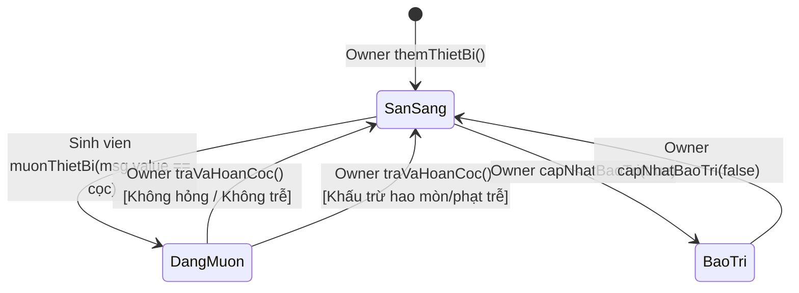
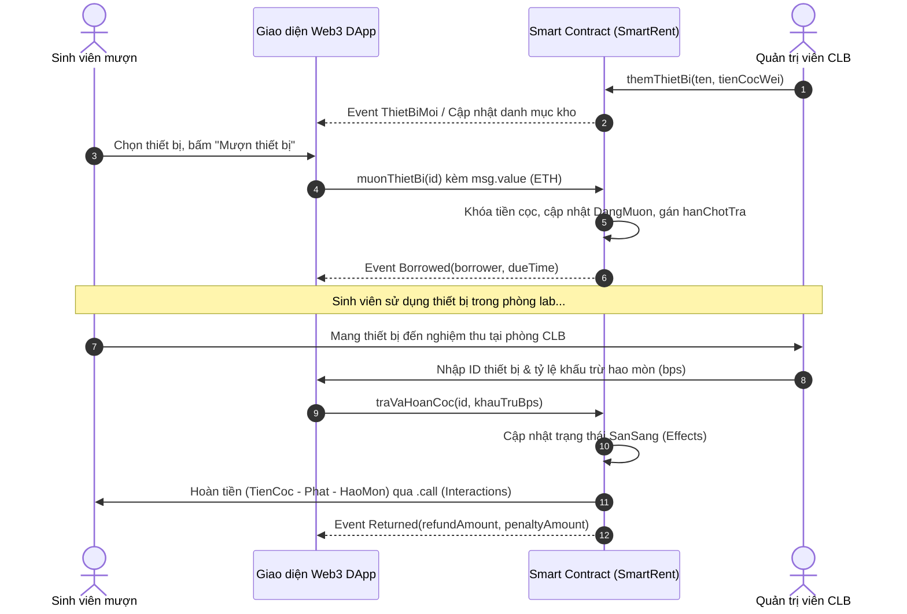

# SPEC — Quản Lý Đặt Cọc Mượn Trả Thiết Bị (SmartRent v0.1)

## 1. Mục đích

Hệ thống quản lý và tự động hóa quy trình đặt cọc, mượn và hoàn trả thiết bị bằng Smart Contract minh bạch trên Blockchain Sepolia, giúp phòng thực hành/lab trường học và sinh viên tránh thất thoát tài sản, loại bỏ gian lận và giải quyết tranh chấp tiền cọc tự động.

---

## 2. Đầu vào

- `themThietBi(string calldata _tenThietBi, uint256 _tienCoc)`: Quản trị viên (Owner) cung cấp tên thiết bị và số tiền cọc yêu cầu (đơn vị: wei).
- `capNhatBaoTri(uint256 _id, bool _laBaoTri)`: Quản trị viên cung cấp ID thiết bị và trạng thái chuyển sang bảo trì hoặc sẵn sàng.
- `muonThietBi(uint256 _id)` / `borrow()`: Người mượn cung cấp ID thiết bị và gửi kèm giá trị `msg.value` (ETH) đúng bằng tiền cọc quy định.
- `traVaHoanCoc(uint256 _id, uint256 _khauTruBps)` / `returnDevice()`: Quản trị viên nghiệm thu và hoàn cọc (tự động tính tiền phạt trễ hạn theo ngày và trừ vào tiền cọc).

---

## 3. Quy tắc nghiệp vụ có thể kiểm thử (Tối thiểu 4 quy tắc)

- **Quy tắc 1 (Ai được làm gì):** 
  - Chỉ có tài khoản Quản trị viên (`owner`) mới có quyền thêm mới thiết bị vào kho và chuyển đổi trạng thái bảo trì của thiết bị.
  - *Kiểm thử:* Ví không phải Owner gọi các hàm quản trị phải bị từ chối với lỗi `NotOwner`.

- **Quy tắc 2 (Khi nào được mượn):** 
  - Người mượn chỉ được phép mượn khi thiết bị đang ở trạng thái sẵn sàng (`State.Created` hoặc `TrangThai.SanSang`) và gửi kèm chính xác số tiền cọc quy định (`msg.value == depositAmount`).
  - *Kiểm thử:* Mượn thiết bị đang có người mượn hoặc gửi thiếu tiền cọc phải báo lỗi `WrongState` hoặc `WrongDepositAmount`.

- **Quy tắc 3 (Giới hạn bao nhiêu):** 
  - Toàn bộ tiền cọc ETH được ký quỹ an toàn trực tiếp trên hợp đồng trong suốt quá trình mượn.
  - Tiền phạt trễ hạn được tính theo công thức: $\text{Tiền phạt} = \text{Số ngày trễ} \times \text{Mức phạt mỗi ngày}$.
  - Tỷ lệ khấu trừ khi hoàn cọc tối đa không được vượt quá 100% tiền cọc.
  - *Kiểm thử:* Trễ hạn nhiều ngày thì tiền phạt tối đa chỉ bằng 100% tiền cọc, không bị âm số dư.

- **Quy tắc 4 (Lỗi thì sao & Xử lý hoàn tiền):** 
  - Mọi hàm thay đổi trạng thái nếu không thỏa mãn điều kiện đều bị revert ngay lập tức và hoàn trả nguyên vẹn lượng gas chưa sử dụng bằng các custom error.
  - Khi hoàn cọc, trạng thái thiết bị và người mượn phải được cập nhật trước (Effects), sau đó mới thực hiện chuyển ETH hoàn cọc qua lệnh `call` (Interactions). Nếu chuyển tiền thất bại, toàn bộ giao dịch phải revert.

---

## 4. Đầu ra

- Phát sự kiện on-chain minh bạch cho mọi giao dịch thay đổi trạng thái:
  - `Borrowed(address indexed borrower, uint256 deposit, uint256 dueTime)`
  - `Returned(address indexed borrower, uint256 refundAmount, uint256 penaltyAmount)`
  - `DeviceReset()`
- Hàm tra cứu công khai `timeLeft()` và `calculatePenalty()` trả về thời gian mượn còn lại và số tiền phạt thực tế.

---

## 5. Sơ đồ Máy trạng thái & Kiến trúc Luồng nghiệp vụ

### 5.1 Máy trạng thái thiết bị (Device State Machine)

### 5.2 Trình tự Luồng ký quỹ & Hoàn tiền (Sequence Flow)

---

## 6. Trường hợp ngoại lệ

- **E1:** Người dùng gửi thừa hoặc thiếu tiền cọc khi mượn ➔ Revert `WrongDepositAmount()`.
- **E2:** Người dùng gọi thao tác mượn trên thiết bị đang có người mượn ➔ Revert `WrongState()`.
- **E3:** Người không có quyền gọi hoàn cọc ➔ Revert `NotOwner()`.
- **E4:** Địa chỉ ví người mượn là hợp đồng từ chối nhận ETH khi hoàn tiền ➔ Revert `TransferFailed()`.

---

## 7. Ngoài phạm vi

- Hệ thống không định vị GPS vị trí vật lý ngoại đời của thiết bị.
- Hệ thống không tự động thẩm định mức độ hư hại phần cứng (phải do Thủ kho kiểm tra thực tế rồi nhập tỷ lệ khấu trừ).
- Chưa hỗ trợ đặt cọc bằng ERC20 token đa dạng (chỉ sử dụng Native ETH trên Sepolia).
